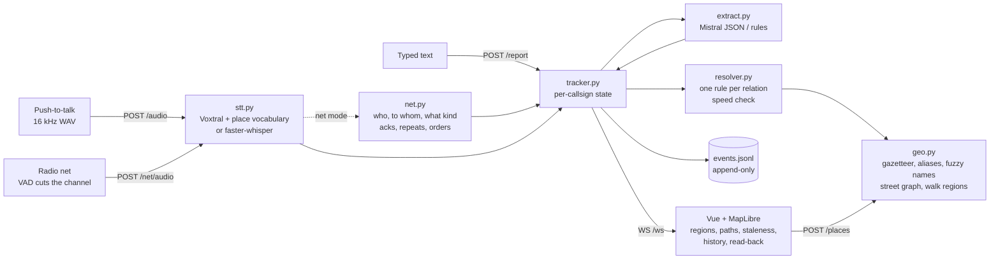

# Voice-to-Map: System Design

Companion to [PRD.md](PRD.md). Describes the code as of 20 November 2026 and the planned next components.

## 1. Principles

1. **The language model names; geometry decides.** The model returns who, which place, which relation and how far. It never
   returns coordinates. Every region comes from testable rules over OpenStreetMap data.
2. **Never plot a guess.** Unknown, out-of-area or unreachable places are flagged with a reason, not drawn confidently.
3. **The log is the source of truth.** State is rebuilt by replaying `data/events.jsonl`. Corrections append; nothing is erased.
4. **Every stage degrades, none stops.**
   - Mistral fails → the rule-based parser takes over.
   - No speech-to-text key → local Whisper, then the browser's recogniser.
   - Streets not routable → a straight line.
5. **Measure each stage.** Every event carries its speech, extraction and total latency.

## 2. Architecture



The backend is one FastAPI process with no database. The gazetteer of one district (about 380 places, of which 166 are streets, with
1,737 street-graph nodes) lives in memory.

## 3. Components

| File | Responsibility | Key design choices |
|---|---|---|
| `backend/stt.py` | WAV clip → text | Voxtral (`voxtral-mini-transcribe-3`) with `context_bias`: up to 100 district names, one form field each. faster-whisper with `initial_prompt` and voice-activity filtering offline. Provider is chosen by environment variable. |
| `backend/extract.py` | Text → `{speaker, reports[]}` | Mistral `json_object` mode with rules and few-shot examples in English and French, temperature 0, 8 s timeout. Rule-based parser as offline mode and as fallback on any error. |
| `backend/tracker.py` | Transmission → events; state | Groups reports by subject. Handles correction, holding, intent and "previous". Combines several clues about one unit. Writes and replays the log. |
| `backend/resolver.py` | One report + context → region | Relation rules (Section 5.2). Speed check. Out-of-area guard. |
| `backend/geo.py` | Places and walking | Matching tiers, aliases, custom points, the street graph and `walk_region`. |
| `backend/net.py` | Transcript → transmissions → events | Splits at "over". Attributes speaker and addressee from procedure and conversation order (Section 5.7). Classifies report, request, order, ack, say again, radio check, call, chatter. Never plots control or an unidentified speaker. Own append-only log, `data/net.jsonl`. |
| `backend/vad.py`, `frontend/src/vad.js` | Audio → transmissions | Energy detector: start above 3× the noise floor, stop after 0.7 s below 2×, 0.25 s pre-roll, 0.35 s minimum, 30 s maximum. The server learns the floor from the whole file; the browser learns it live (warm-up, falls fast, rises slowly). |
| `backend/app.py` | HTTP and WebSocket | Thin layer over the tracker; broadcasts events and corrections. |
| `frontend/src/App.vue` | Shared map | Recording to WAV in the browser, staleness rings, struck-through corrections, right-click naming, read-back. |

## 4. Data model

**Transmission** (extractor output):

```json
{"speaker": "alpha 2",
 "reports": [{"subject": null, "type": "position|movement|correction|holding|intent|other",
              "anchor": {"name": "saint sulpice church", "kind": "landmark|street|intersection|unit"},
              "anchor2": null, "relation": "south_of", "distance_m": null, "minutes_ago": null, "confidence": 0.9}],
 "extractor": "mistral:mistral-small-latest", "extract_ms": 420}
```

**Event** (one per unit per transmission; broadcast and logged):

| Field | Meaning |
|---|---|
| `id`, `t`, `callsign`, `speaker`, `text`, `source` | identity, time, who it is about, who said it, transcript, text or voice |
| `ok`, `region` (GeoJSON), `centre`, `radius_m` | the answer; `radius_m` is the radius of a circle of equal area |
| `anchor`, `ambiguous`, `alternatives`, `note` | what it was resolved against and how sure it is |
| `type`, `parsed`, `superseded`, `corrects` | report type, the report used, and correction links |
| `extractor`, `latency_ms {stt, extract, total}`, `transcript_meta` | audit trail and timing |

**Log lines** have three kinds: `event`, `supersede {id}` and `reset`. Replaying them rebuilds the event list and each callsign's
standing fixes.

**Hand-edited data:**
- `data/aliases.json`: spoken name → OSM name.
- `data/custom_places.json`: operator-named points (git-ignored).

## 5. Algorithms

### 5.1 Place matching (`Gazetteer.find`)

1. **Alias.** A spoken name in `aliases.json` is replaced by its OSM name.
2. **Normalise.** Lower-case, strip accents, punctuation and stop words ("the", "de", "du"). Fold variants: "st" and "san" →
   "saint", "palace" → "palais", "street" → "rue".
3. **Score tiers.**
   - 0: exact match.
   - 1: all spoken words appear in the name.
   - 2: category word plus name words ("Saint Sulpice church").
   - 3: bare category word ("the church").
   - 4: every spoken word is close to a word of the name and at least one matches exactly ("Rude Rennes" → Rue de Rennes).
   - 5: whole-string fuzzy match.
4. **Retry wider.** Retry without the street/landmark guess. Then drop trailing words ("medici fountain in the luxembourg
   gardens" → "medici fountain").
5. **Rank.** Order by score, then distance to the unit's last region, then buildings before bare points, then the larger place.

### 5.2 Relation rules (`resolve`)

| Relation | Region |
|---|---|
| at | landmark footprint + 20 m (bare point + 25 m), street + 12 m (trimmed to 250 m around the last fix), unit + 15 m |
| near | footprint + 50 m, or + the spoken distance |
| north_of … southwest_of | 70° wedge from the centre, starting outside the footprint; band of 0.7–1.3 × the spoken distance |
| intersection | shared node of both streets (or nearest points if they meet across a square) + 20 m |
| between | corridor between the two anchors, 25 m each side |
| behind / in_front_of | wedge away from or towards the unit's last position; flagged ambiguous (convention open) |
| towards / along | `walk_region` (below); straight-line corridor if the streets cannot be used |
| previous | the fix standing at "now − minutes_ago" |
| unit anchor | the other unit's current region |

### 5.3 Speed check

For position reports with a previous fix, the reach is `elapsed × 4 m/s + 150 m`.
- If the top candidate is out of reach but another candidate is within reach, take the reachable one and say so.
- If no candidate is within reach, plot the best one but mark it ambiguous: "implausible move: 414 m in 10 s; check the place name".

### 5.4 Walking region

The goal is "where can the unit be after walking towards X for t seconds?".
1. Build a graph from the named streets.
2. Run one Dijkstra outward from every node on the target. This gives each node its shortest way to the target.
3. For up to 24 street nodes inside the unit's last region, follow that way for `cap` metres, where
   `cap = max(30, elapsed × 1.5 m/s)` or a spoken distance.
4. Take the union of those walks, each widened by 30 m.

Because the start is uncertain, routes on both sides of a building are kept. This takes about 10–25 ms in the district.

### 5.5 Combining clues and corrections

- **Several clues about one unit in one transmission** ("west side of the square, by the town hall"): use the intersection of their
  regions if it is non-empty. Otherwise use the smallest region (the most specific clue).
- **Corrections:** the last standing fix is withdrawn (`supersede`). It stays as context for resolving names, so "the church" still
  means the church just mentioned. The correction is then resolved as a new fix.

### 5.6 Staleness (client side)

The ring radius is `radius_m + 1.5 m/s × seconds since the report`, capped at 1.5 km. It redraws every 5 s.

### 5.7 Radio-net attribution (`Net._attribute`)

Each transmission gets a speaker, an addressee, a kind, and the reason for the attribution (shown in the log).

1. **Named in the call.** "X, this is Y", "X ici Y", "X de Y", or the abbreviated "X, Y" make Y the speaker. Atomic regex groups
   stop "Bravo one is …" from being read as a call to "Bravo".
2. **One callsign X at the start.**
   - If X was just called, X is answering with its own callsign.
   - If X spoke last, someone is answering X (the other party of the exchange, or control).
   - With no context, X is the speaker of a report, and the addressee of a request, order or call (from control).
   - A control callsign at the start is always the addressee: control does not report its own position.
3. **No callsign.**
   - It is the rest of the previous transmission if that stopped less than 3 s ago without "over".
   - Otherwise it is the reply of the station just called (within 45 s, unless the exchange ended with "out").
   - An acknowledgement after a unit's report is from control.
4. **Otherwise** the speaker is not identified. The transmission is logged; reports in it are not plotted unless they name their
   subject ("Delta one is at …").

Effects:

- **Ack** annotates the events of the last transmission from the station it addresses with `acked_by`.
- **Say again** annotates them with `queried_by`. The next report from that station within 120 s supersedes the queried fix,
  if it is still the station's latest.
- **Order** ("move to X", "hold position") creates an `order` event for the addressee with the destination resolved like
  "at X". A later position report within 40 m of it sets `reached`.

## 6. Interfaces

| Endpoint | In | Out |
|---|---|---|
| `POST /report` | `{text, callsign?}` | `{events: [...]}`, also broadcast |
| `POST /audio?callsign=&lang=` | `audio/wav` body | `{transcript, events}`; 501 with no speech-to-text provider (the client falls back to browser recognition) |
| `GET /state` | | centre, bbox, events, custom places, speech-to-text provider |
| `POST /places` | `{name, lon, lat}` | custom places; broadcast `places` |
| `GET /export.geojson` | | standing fixes as a FeatureCollection |
| `POST /net/text` | `{text, t?}` (`t` only for replays) | `{transmissions, events}`, also broadcast |
| `POST /net/audio?lang=&t=&dur=` | one VAD-cut transmission, `audio/wav` | `{transcript, transmissions, events}`; 501 with no speech-to-text provider. The client's capture time is used if within 120 s of the server clock |
| `POST /net/recording?lang=` | a recorded net, PCM WAV | cut, transcribed in order, timed so the last transmission is now |
| `POST /net/replay?speed=` | | plays `data/demo_net.jsonl` in the background; 409 if one is running |
| `POST /reset` | | writes reset markers to both logs; broadcast `reset` |
| `WS /ws` | | `event`, `supersede {id, by}`, `tx` (a transmission), `annotate {id, fields}` (ack, query, arrival), `places`, `reset` |

## 7. Latency budget

| Stage | Target | Measured (laptop, 20 Nov) |
|---|---|---|
| Release button → WAV ready (browser decode and resample) | < 150 ms | not measured |
| Speech-to-text, 3 s clip | < 800 ms (file); partial text within 300 ms (streaming) | not measured (no key) |
| Extraction | < 700 ms (Mistral Small); < 5 ms (rules) | rules 1–2 ms |
| Resolve, route, log, broadcast | < 50 ms | 1–25 ms |
| **Total** | **< 2 s median** | text → map: 2–25 ms |

The biggest remaining lever is **streaming speech-to-text**: transcribe while the person is still talking, so only the final segment
waits after release.

## 8. Deployment profiles

| Profile | Speech-to-text | Extraction | Tiles | Use |
|---|---|---|---|---|
| Online | Voxtral API with `context_bias` | Mistral API | OSM raster | Development, default demo |
| Offline | faster-whisper `small`/`medium` (or Voxtral Mini 4B Realtime open weights via vLLM/MLX) | Ministral 3 8B via llama.cpp, LM Studio or vLLM (to add: an OpenAI-compatible base URL) | PMTiles file of the district | Wi-Fi-off demo; matches Lysk's operating constraint |
| Fallback | Browser recogniser | Rules | cached | Anything failing on stage |

## 9. Failure modes

| Failure | Behaviour |
|---|---|
| Mistral timeout or error | Rules extractor; event records `extractor: rules (mistral failed: …)` |
| Speech-to-text error | HTTP 502 with reason; transcript box shows it; typing still works |
| Unknown or outside place | Not plotted; note asks to say again or name a nearby street |
| Ambiguous name | Plotted with a dashed outline and alternatives listed |
| Impossible move | Plotted dashed with an "implausible move" note |
| Server restart | Log replay restores events, corrections, annotations, fixes and the net log |
| Speaker not identified on the net | Logged and shown in red with what was heard; not plotted |
| VAD cuts one transmission in two | The second part, with no callsign and under 3 s later, is joined to the first speaker |
| VAD merges two transmissions | Split at "over" or "out" when a sentence ends there or a callsign follows |
| Read-back heard by the net microphone | Read-back is off for radio-net events |

## 10. Testing and evaluation

- `pytest`: 48 tests.
  - Matching, relation rules, routing, the speed check, corrections, intent, holding, history, units as anchors, several units
    per call, radio procedure, French and log replay.
  - Radio net: the 24-line demo net attributed line by line, reply, ack, say-again, order and arrival, relay, continuation,
    splitting, net-log replay, and the endpoints end to end with scripted speech-to-text.
  - Voice-activity detection on synthetic radio audio (boundaries, clicks, quiet stations, long transmissions, resampling).
- `scripts/make_demo_net.py` (macOS): the demo net voiced and band-limited. Both VADs (Python and browser) cut 24 of 24
  transmissions, with boundaries within 0.3 s.
- `scripts/evaluate.py`: smoke test.
- `scripts/stress.py` with `tests/stress.jsonl`: 48 judge-style sentences with truth points and expected behaviour, compared with a
  naive baseline.
  - Before these changes: 22/48. After: 48/48.
  - The set was used for tuning, so the held-out set is still to do.

## 11. Security and privacy

No accounts and no secrets in the client. The API key stays on the server. CORS is open for local development; close it before
anything else. Audio is not stored (only transcripts). Map tiles are fetched from the public OSM server; switch to PMTiles offline.

## 12. APIs, libraries and plugins to explore for performance

Ordered by expected payoff for this challenge.

**Speech (biggest effect on latency and accuracy):**
- **Voxtral realtime** (`wss://api.mistral.ai/v1/audio/transcriptions/realtime`, model `voxtral-mini-transcribe-realtime-3`):
  streams 16 kHz PCM and returns partial text; accepts `context_bias`. Cuts post-release wait.
- **Voxtral Mini 4B Realtime** (open weights, Apache 2.0) on vLLM or MLX: the same model offline.
- **faster-whisper / whisper.cpp / mlx-whisper**: Whisper is what Lysk runs. Use `initial_prompt` with place names. Try `small`
  versus `large-v3-turbo` for the speed and accuracy trade-off.
- **Silero VAD** (or webrtcvad): end-of-speech detection and silence trimming. Needed for radio-net mode (no button).
- **Diarisation** (Voxtral `diarize=true`, or pyannote): several speakers on one channel.
- **Noise suppression**: browser `noiseSuppression` (on), RNNoise or DeepFilterNet for recorded radio.

**Language:**
- **Mistral structured outputs** (`client.chat.parse` with a Pydantic schema): stricter than `json_object`.
- **Ministral 3 8B / 3B**: faster extraction, and runs locally.
- **Function calling**: an alternative way to get the schema.

**Places and geometry:**
- **RapidFuzz + jellyfish (Double Metaphone)**: faster, phonetic matching for misheard names, replacing difflib.
- **osmnx**: proper pedestrian graph including footpaths and squares; building footprints and `entrance=main` for
  "in front of".
- **Photon** (fuzzy OSM geocoder, self-hostable): names outside the pre-loaded district.
- **Overpass API** (used now). **Nominatim** only as a last resort (public use limited to 1 request/s).
- **pyproj**: Lambert-93 (EPSG:2154) instead of the local flat approximation when the map grows past a district.
- **mgrs / pygeodesy**: spoken grid references.

**Map and interface:**
- **PMTiles + Protomaps basemaps**: offline vector tiles in one file. **OpenFreeMap**: key-free online vector tiles.
- **milsymbol.js**: NATO APP-6 / MIL-STD-2525 unit symbols.
- **deck.gl TripsLayer**: animated history replay.
- **turf.js**: client-side geometry.
- **terra-draw**: drawing checkpoints and phase lines.

**Interoperability:**
- **Cursor-on-Target via pytak**: positions into ATAK, WinTAK or iTAK. FreeTAKServer for local testing.
- GeoJSON (done) and KML export.

**Operations:**
- **OpenTelemetry** spans per stage (the package is already in the virtual environment as a dependency).
- WebRTC or a Twilio/SIP number for "report from any phone".
